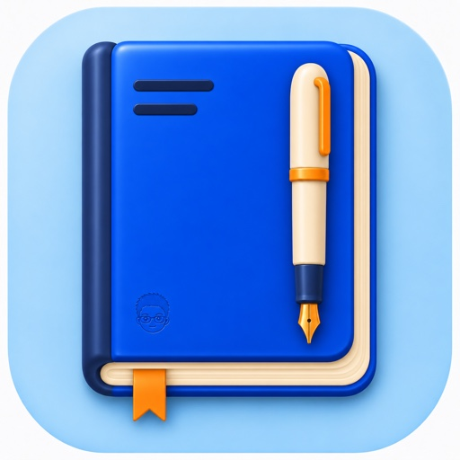
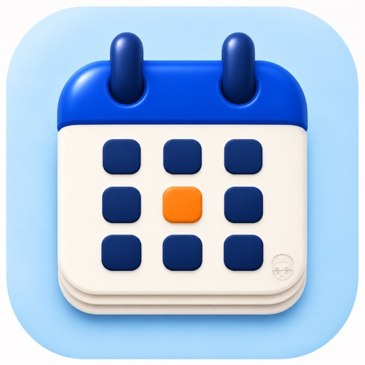
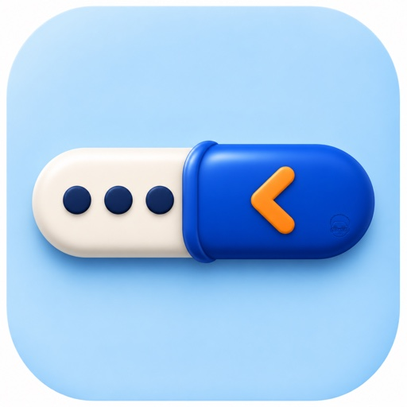
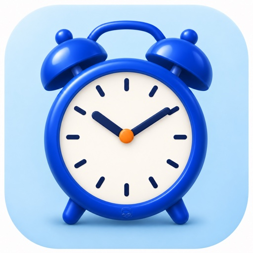
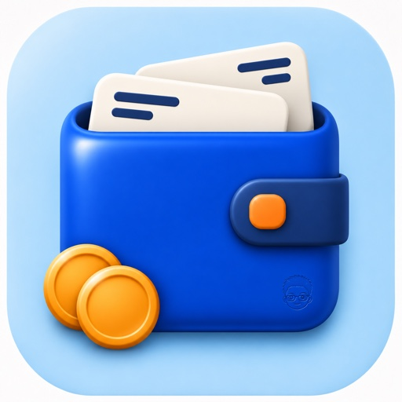
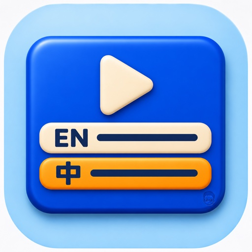

```{=html}
<main class="page-shell">
  <h1 class="page-title">Projects</h1>

  <section class="vibe-coding" aria-labelledby="vibe-coding-title">
    <h2 id="vibe-coding-title">Vibe Coding</h2>
    <div class="vibe-intro">
      <p>These are the apps and plug-ins I’ve cobbled together with whichever AI was available and willing to tolerate me — Doubao, Gemini, Codex, Claude, the usual suspects.</p>
      <p>We live in an absurd era. A wildly specific need pops into your head, and instead of paying £4.99 a month for an app that almost does the job, you ask a chatbot to build exactly what you want. Three hours and seventeen “one tiny changes” later, you have your very own app and a new understanding of why developers charge money.</p>
      <p>Below is a growing collection of solutions to problems that may exist only in my life. Most of them work. Some work surprisingly well. I’m rather fond of them.</p>
      <p>Have a play, borrow an idea, then go build something unreasonable of your own. Updates and new toys will arrive whenever inspiration strikes and I have successfully avoided my actual responsibilities.</p>
    </div>

    <div class="app-picker" role="tablist" aria-label="Vibe Coding apps">
      <button class="app-tab is-active" id="tab-notebook" type="button" role="tab" aria-selected="true" aria-controls="panel-notebook" tabindex="0" data-app-tab="notebook">
        <span>Notebook</span>
      </button>
      <button class="app-tab" id="tab-calendar" type="button" role="tab" aria-selected="false" aria-controls="panel-calendar" tabindex="-1" data-app-tab="calendar">
        <span>Calendar</span>
      </button>
      <button class="app-tab" id="tab-menubar" type="button" role="tab" aria-selected="false" aria-controls="panel-menubar" tabindex="-1" data-app-tab="menubar">
        <span>MenuBar</span>
      </button>
      <button class="app-tab" id="tab-focus" type="button" role="tab" aria-selected="false" aria-controls="panel-focus" tabindex="-1" data-app-tab="focus">
        <span>Focus</span>
      </button>
      <button class="app-tab" id="tab-finance" type="button" role="tab" aria-selected="false" aria-controls="panel-finance" tabindex="-1" data-app-tab="finance">
        <span>Finance</span>
      </button>
      <button class="app-tab" id="tab-dualsub" type="button" role="tab" aria-selected="false" aria-controls="panel-dualsub" tabindex="-1" data-app-tab="dualsub">
        <span>DualSub</span>
      </button>
    </div>

    <div class="app-panels" aria-live="polite">
      <article class="app-panel" id="panel-notebook" role="tabpanel" aria-labelledby="tab-notebook" data-app-panel="notebook">
        <h3>Notebook</h3>
        <p>Builds on handwriting notes with PDF import and a freeform Canvas for writing, drawing and annotation.</p>
        <p><a href="https://drive.google.com/drive/folders/1WI1f6OP_SopgPDUQKo6ME92A7j_8AdzA?usp=drive_link" target="_blank" rel="noopener noreferrer">Download from Google Drive</a></p>
        <p><a href="https://pan.baidu.com/s/1YvxMLGmxein9bq3qYz2UNg?pwd=HZZZ" target="_blank" rel="noopener noreferrer">Download from Baidu Netdisk</a> <span class="download-code">(Code: HZZZ)</span></p>
      </article>
      <article class="app-panel" id="panel-calendar" role="tabpanel" aria-labelledby="tab-calendar" data-app-panel="calendar" hidden>
        <h3>Calendar</h3>
        <p>Brings iCloud Calendar events and reminders to your desktop wallpaper, automatically identifying classes and important events from designated fields in event notes.</p>
        <p><a href="https://drive.google.com/drive/folders/1NOxI2WcHmvNghzewEZDKAmYhqMsfxqLS?usp=drive_link" target="_blank" rel="noopener noreferrer">Download from Google Drive</a></p>
        <p><a href="https://pan.baidu.com/s/1P6BIStYrhyEaZVxMDKqXvg?pwd=HZZZ" target="_blank" rel="noopener noreferrer">Download from Baidu Netdisk</a> <span class="download-code">(Code: HZZZ)</span></p>
      </article>
      <article class="app-panel" id="panel-menubar" role="tabpanel" aria-labelledby="tab-menubar" data-app-panel="menubar" hidden>
        <h3>MenuBar</h3>
        <p>Keeps menu bar icons tidy, with optional usage indicators for GPT and Claude.</p>
        <p><a href="https://drive.google.com/drive/folders/1JdWtP7QYM_qACCKWiOBKvxnvAkcBfVap?usp=drive_link" target="_blank" rel="noopener noreferrer">Download from Google Drive</a></p>
        <p><a href="https://pan.baidu.com/s/1pALWnuyVKs4vAbOT3bWlPg?pwd=HZZZ" target="_blank" rel="noopener noreferrer">Download from Baidu Netdisk</a> <span class="download-code">(Code: HZZZ)</span></p>
      </article>
      <article class="app-panel" id="panel-focus" role="tabpanel" aria-labelledby="tab-focus" data-app-panel="focus" hidden>
        <h3>Focus</h3>
        <p>Tracks focus time to support modular learning with positive feedback, visualises daily and weekly progress, and provides session summaries.</p>
        <p><a href="https://drive.google.com/drive/folders/1ILbgD9KAjZO3gG8o0nVvAezRM1j67PLu?usp=drive_link" target="_blank" rel="noopener noreferrer">Download from Google Drive</a></p>
        <p><a href="https://pan.baidu.com/s/1vJ5oATRz_dR8pGM5EYog0A?pwd=HZZZ" target="_blank" rel="noopener noreferrer">Download from Baidu Netdisk</a> <span class="download-code">(Code: HZZZ)</span></p>
      </article>
      <article class="app-panel" id="panel-finance" role="tabpanel" aria-labelledby="tab-finance" data-app-panel="finance" hidden>
        <h3>Finance</h3>
        <p>An all-in-one finance manager for student life abroad, covering accounts, income and expenses, category budgets and transaction tracking.</p>
        <p><a href="https://drive.google.com/drive/folders/1czOmzHpdfwfpXiiQdRUhWcitO3bv0wIC?usp=drive_link" target="_blank" rel="noopener noreferrer">Download from Google Drive</a></p>
        <p><a href="https://pan.baidu.com/s/1OG1Gkdx0rR5t86rCKDZ8rg?pwd=HZZZ" target="_blank" rel="noopener noreferrer">Download from Baidu Netdisk</a> <span class="download-code">(Code: HZZZ)</span></p>
      </article>
      <article class="app-panel" id="panel-dualsub" role="tabpanel" aria-labelledby="tab-dualsub" data-app-panel="dualsub" hidden>
        <h3>DualSub</h3>
        <p>Provides bilingual subtitles for streaming platforms including YouTube, HBO Max, Disney+, Channel 4 and Netflix, as well as KCL’s Echo360 lecture recordings, with translations processed locally.</p>
        <p><a href="https://drive.google.com/drive/folders/1W9mbIagWbNcNLZurwGCeECck507pB0G7?usp=drive_link" target="_blank" rel="noopener noreferrer">Download from Google Drive</a></p>
        <p><a href="https://pan.baidu.com/s/1XFztZasQp-GNO7LLBch8Bg?pwd=HZZZ" target="_blank" rel="noopener noreferrer">Download from Baidu Netdisk</a> <span class="download-code">(Code: HZZZ)</span></p>
      </article>
    </div>
  </section>
</main>

<script>
document.addEventListener("DOMContentLoaded", () => {
  const tabs = [...document.querySelectorAll("[data-app-tab]")];
  const panels = [...document.querySelectorAll("[data-app-panel]")];

  function selectApp(name, focus = false) {
    tabs.forEach((tab) => {
      const selected = tab.dataset.appTab === name;
      tab.classList.toggle("is-active", selected);
      tab.setAttribute("aria-selected", String(selected));
      tab.tabIndex = selected ? 0 : -1;
      if (selected && focus) tab.focus();
    });
    panels.forEach((panel) => {
      panel.hidden = panel.dataset.appPanel !== name;
    });
  }

  tabs.forEach((tab, index) => {
    tab.addEventListener("click", () => selectApp(tab.dataset.appTab));
    tab.addEventListener("keydown", (event) => {
      let next = index;
      if (event.key === "ArrowRight") next = (index + 1) % tabs.length;
      else if (event.key === "ArrowLeft") next = (index - 1 + tabs.length) % tabs.length;
      else if (event.key === "Home") next = 0;
      else if (event.key === "End") next = tabs.length - 1;
      else return;
      event.preventDefault();
      selectApp(tabs[next].dataset.appTab, true);
    });
  });
});
</script>
```
